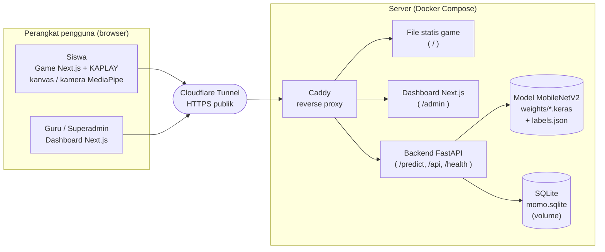
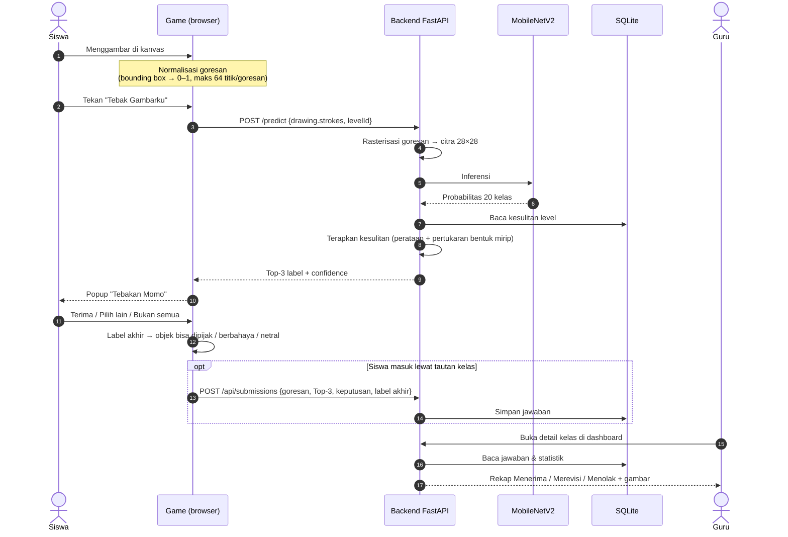
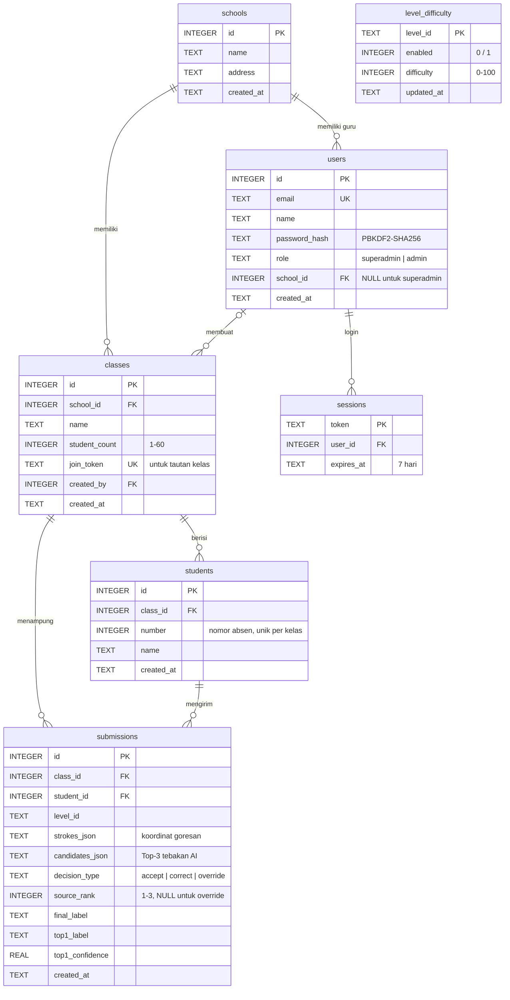
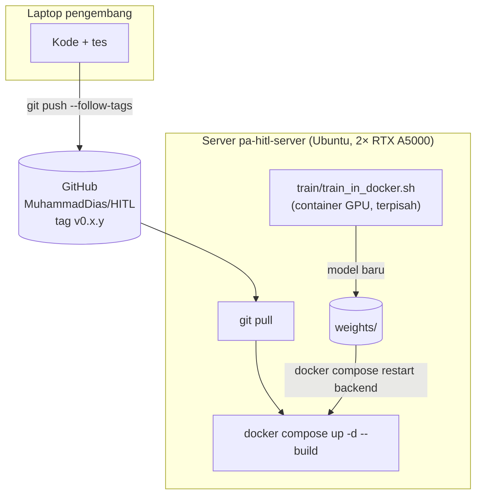

# Diagram Sistem Sketchbook Universe

Diagram ditulis dalam **Mermaid**, sehingga tampil otomatis di GitHub. Untuk dimasukkan ke dokumen Word/PDF,
salin blok kode ke [mermaid.live](https://mermaid.live), lalu unduh sebagai PNG atau SVG.

## 1. Arsitektur sistem

## 2. Alur gambar sampai keputusan tercatat

## 3. Entity Relationship Diagram (ERD)

`level_difficulty` berdiri sendiri (tanpa relasi): `level_id` mengacu pada identitas level di game
(`stage-1-foundation`, `stage-2-ambiguity`, `stage-3-validation`).

## 4. Deployment

